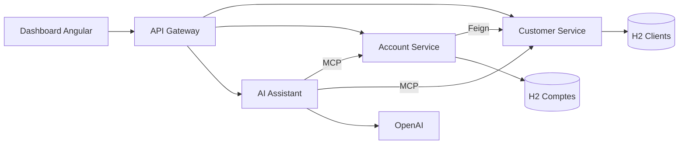

# Banking Microservices — Architecture distribuée et assistant IA MCP

**Projet d'évaluation présenté par Fatimaezzahra Zahnoune**

Application pédagogique de gestion bancaire mettant en œuvre **Java 21**, **Spring Boot**, **Spring Cloud**, **Consul**, **OpenFeign**, **Spring AI / MCP**, **OpenAI**, **Angular** et **Docker Compose**. Le système présente les fonctionnalités métier, les APIs, les composants distribués et une interface web.

## Sommaire
1. [Fonctionnalités](#fonctionnalités)
2. [Architecture et modules](#architecture-et-modules)
3. [Modèle de données](#modèle-de-données)
4. [API et outils MCP](#api-et-outils-mcp)
5. [Environnement et démarrage](#environnement-et-démarrage)
6. [Tests](#tests)
7. [Documentation approfondie](#documentation-approfondie)
8. [Références pédagogiques](#références-pédagogiques)

## Fonctionnalités

### Gestion des clients
Les créations et mises à jour vérifient les champs obligatoires (nom et email) et le format de l'email. Les demandes de clients ou de comptes inexistants renvoient HTTP 404 ; les messages vides destinés au chatbot sont refusés avec HTTP 400.

- Consulter, créer, modifier et supprimer les clients via une API REST.
- Consulter un client par identifiant et lister les clients.
- Exposer les outils MCP `getCustomerById` et `getAllCustomers`.

### Comptes bancaires et transactions
- Créer et consulter des comptes ; retrouver les comptes d'un client.
- Enrichir un compte avec les informations client via OpenFeign et Consul.
- Effectuer des dépôts et des retraits ; conserver un historique de transactions.
- Valider les montants : les valeurs négatives, nulles ou non finies sont rejetées.
- Refuser un retrait si le solde disponible est insuffisant.
- Fournir les outils MCP `getAccountById`, `getAccountsByCustomerId`, `getTransactionsByAccountId`, `deposit`, `withdraw`.

### Infrastructure et IA
- Découverte des services avec Consul ; Gateway unique pour les appels REST.
- Deux serveurs MCP et un client Spring AI capable de fournir leurs outils au modèle OpenAI.
- Assistant conversationnel accessible via `POST /chat/ask` et une interface HTML autonome.
- Dashboard Angular pour consulter les listes de clients et de comptes, avec états de chargement et erreurs.

## Architecture et modules

```text
banking-microservices-project/
├── README.md
├── CLAUDE.md
├── docs/
│   └── ARCHITECTURE.md
├── .github/workflows/verification.yml
└── banking-platform/
    ├── customer-service/
    ├── account-service/
    ├── api-gateway/
    ├── ai-assistant-service/
    ├── banking-dashboard/
    ├── chatbot.html
    ├── docker-compose.yml
    └── README.md
```

| Module | Rôle | Port |
|---|---|---:|
| `customer-service` | Clients, JPA/H2, REST et serveur MCP | 8081 |
| `account-service` | Comptes, transactions, Feign et serveur MCP | 8082 |
| `api-gateway` | Routage HTTP via Spring Cloud Gateway | 8888 |
| `ai-assistant-service` | ChatClient Spring AI, OpenAI et client MCP | 8083 |
| `banking-dashboard` | Interface Angular | 4200 |
| Consul (Docker) | Découverte des services | 8500 |

Les noms de modules sont ceux des dossiers du projet. Les identifiants Spring configurés pour Consul peuvent différer de ces noms : ils sont détaillés dans [l'architecture](docs/ARCHITECTURE.md).



## Modèle de données
- `Customer` : identifiant, nom, email et téléphone.
- `Account` : identifiant, RIB, solde, identifiant client.
- `Transaction` : identifiant, montant, date, type et compte.
- `TransactionType` : `DEPOT` ou `RETRAIT`.
- Les deux bases H2 sont distinctes et en mémoire ; la liaison client-compte repose sur `customerId`.

Le [diagramme de classes](docs/ARCHITECTURE.md#2-modèle-métier--diagramme-de-classes) et les diagrammes de séquence figurent dans le dossier d'architecture.

## API et outils MCP

Les endpoints accessibles par la Gateway incluent :
- `GET /api/customers`, `GET /api/customers/{id}`, `POST /api/customers`, `PUT /api/customers/{id}`, `DELETE /api/customers/{id}`.
- `GET /api/accounts`, `GET /api/accounts/{id}`, `POST /api/accounts`.
- `GET /api/accounts/customer/{customerId}`, `GET /api/accounts/{id}/details`, `GET /api/accounts/{id}/transactions`.
- `POST /api/accounts/{id}/depot?amount=100`, `POST /api/accounts/{id}/retrait?amount=50`.
- `POST /api/chat/ask` avec JSON `{"message":"Quel est le solde du compte 1 ?"}`.

Les serveurs MCP sont accessibles sur `/mcp` des services métier aux ports 8081 et 8082.

## Environnement et démarrage

### Prérequis
Java 21, Maven 3.9 ou compatible, Docker avec Compose, Node.js compatible Angular 22 et npm. Une clé API OpenAI est nécessaire pour l'assistant.

**Ne pas publier de clé API.** Définir `OPENAI_API_KEY` comme variable d'environnement locale (ou dans la configuration de lancement de l'IDE) :

```powershell
$env:OPENAI_API_KEY="votre-cle-api"
```

### Consul
```powershell
cd banking-platform
docker compose up -d
```

### Services Java
Ouvrir un terminal indépendant par service, depuis `banking-platform` :
```powershell
cd customer-service
mvn spring-boot:run
```
Répéter `mvn spring-boot:run` dans `account-service`, `api-gateway` et `ai-assistant-service` (après le démarrage des services métier et la configuration de la clé OpenAI).

### Interface Angular
```powershell
cd banking-platform/banking-dashboard
npm ci
npm start
```
Dashboard : `http://localhost:4200`, Consul : `http://localhost:8500`, Gateway : `http://localhost:8888`.

## Tests

Les contrôles sont définis dans [GitHub Actions](.github/workflows/verification.yml) et couvrent quatre modules Java ainsi que le build Angular.

- `AccountControllerTest` : **12 tests**, couvrant les dépôts et retraits REST.
- `AccountToolsTest` : **15 tests**, couvrant la délégation des outils MCP.
- `BankingTransactionServiceTest` : **15 tests**, couvrant les dépôts, retraits, montants invalides, erreurs métier et dépassements numériques.
- Sur la dernière exécution CI contrôlée le 19 octobre 2026 : **42 tests bancaires réussis**, 0 échec, 0 erreur et 0 test ignoré.
- La compilation de tous les modules Java et du dashboard Angular a réussi dans ce même workflow.

Depuis `banking-platform/account-service` : `mvn test`. Depuis `banking-platform/banking-dashboard` : `npm run build`.

Ces contrôles vérifient le code et le build ; ils ne constituent pas un test d'intégration complet des cinq composants démarrés simultanément.

## Documentation approfondie

- [Documentation complète de la plateforme](banking-platform/README.md)
- [Architecture globale, cas d'utilisation, classes et séquences](docs/ARCHITECTURE.md)
- [Guide de maintenance et cartographie des classes](CLAUDE.md)
- [Gestion des clients](banking-platform/customer-service/README.md)
- [Comptes et transactions](banking-platform/account-service/README.md)
- [API Gateway](banking-platform/api-gateway/README.md)
- [Assistant IA](banking-platform/ai-assistant-service/README.md)
- [Dashboard Angular](banking-platform/banking-dashboard/README.md)

## Limites techniques
Application à vocation pédagogique, et non bancaire de production : authentification et autorisation absentes, soldes représentés en `double`, H2 volatil, logique transactionnelle REST/MCP centralisée mais sans protection contre les accès concurrents, outils financiers MCP accessibles sans politique de sécurité applicative. Le dashboard est en lecture seule ; la page du chatbot HTML est accessible depuis le dashboard à l'adresse `/chatbot.html`.

## Références pédagogiques
- [Tutoriel YouTube — Partie 1](https://www.youtube.com/watch?v=cdFz3VemT1Q)
- [Tutoriel YouTube — Partie 2](https://www.youtube.com/watch?v=JHvxSZTWSsY)
