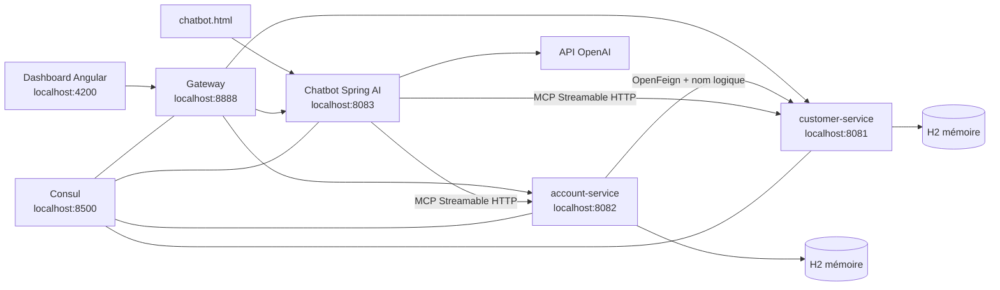

# Projet d'évaluation — Ebank, microservices, Angular et agent IA MCP

**Dossier d'évaluation présenté par : Fatimaezzahra Zahnoune.**

Ce dépôt est une **reproduction pédagogique de deux tutoriels YouTube** consacrés à une
application bancaire en microservices, prolongée par un agent Spring AI utilisant le
Model Context Protocol (MCP) et par une interface Angular.

Le code est destiné à l'apprentissage : il montre la découverte de services, le routage,
un appel interservice avec OpenFeign, l'exposition d'outils MCP et leur utilisation par
un modèle OpenAI. Il ne constitue pas une application bancaire prête pour la production.

## Références pédagogiques

- [Tutoriel YouTube — Partie 1](https://www.youtube.com/watch?v=cdFz3VemT1Q).
- [Tutoriel YouTube — Partie 2](https://www.youtube.com/watch?v=JHvxSZTWSsY).
## Guide de lecture et documentation par module

- [Présentation générale](../README.md)
- [Guide de maintenance et conventions](../CLAUDE.md)
- [Architecture globale, cas d'utilisation, classes et séquences](../docs/ARCHITECTURE.md)
- [Service clients](customer-service/README.md)
- [Service comptes et transactions](account-service/README.md)
- [Passerelle API](api-gateway/README.md)
- [Assistant conversationnel](ai-assistant-service/README.md)
- [Dashboard Angular](banking-dashboard/README.md)

## Fonctionnalités

- gestion CRUD des clients par `customer-service` ;
- consultation et création de comptes, consultation des transactions, dépôts et retraits
  par `account-service` ;
- agrégation d'un compte avec son client par OpenFeign ;
- découverte et enregistrement des services avec Consul ;
- point d'entrée unique avec Spring Cloud Gateway ;
- deux serveurs MCP exposant les clients, comptes et opérations comme outils ;
- agent conversationnel Spring AI connecté à OpenAI (`gpt-4o-mini`) et aux deux serveurs MCP ;
- dashboard Angular en lecture seule pour afficher les comptes et les clients ;
- page HTML autonome permettant d'interroger le chatbot.

Les dépôts et retraits REST refusent avec HTTP 400 les montants négatifs, nuls, `NaN`
ou infinis. Un retrait supérieur au solde disponible est également refusé par le métier.

## Architecture



### Organisation du dépôt

La plateforme est organisée autour de `customer-service`, `account-service`, `api-gateway`, `ai-assistant-service` et `banking-dashboard`. Les identifiants Spring et Consul sont définis dans les configurations YAML de chaque service.

### Modules et ports

| Composant | Port | Rôle |
| --- | ---: | --- |
| Consul | 8500 | registre de services et contrôles de santé |
| `customer-service` | 8081 | clients, base H2, serveur MCP `/mcp` |
| `account-service` (service Spring `ebank-service`) | 8082 | comptes et transactions, Feign, serveur MCP `/mcp` |
| `ai-assistant-service` (service Spring `ebank-chatbot-service`) | 8083 | client MCP, `ChatClient` et OpenAI |
| `api-gateway` (service Spring `gateway-service`) | 8888 | routage `/api/**` vers les services |
| `banking-dashboard` (projet Angular `ebank-dashboard`) | 4200 | interface Angular de consultation |

### Technologies

- Java 21, Spring Boot 3.5.6 et Maven ;
- Spring Cloud 2025.0.0 : Consul Discovery, Gateway et OpenFeign ;
- Spring AI 1.1.8 : serveurs/clients MCP et modèle OpenAI ;
- H2 en mémoire pour les deux services métier ;
- Angular 22, TypeScript 6 et npm ;
- Docker Compose pour Consul.

## API REST

Via la Gateway, préfixer les routes métier par `http://localhost:8888/api`.

### Clients

- `GET /customers` : liste des clients ;
- `GET /customers/{id}` : détail d'un client ;
- `POST /customers` : création ;
- `PUT /customers/{id}` : mise à jour ;
- `DELETE /customers/{id}` : suppression.

### Comptes et transactions

- `GET /accounts` : liste des comptes ;
- `GET /accounts/{id}` : détail d'un compte ;
- `POST /accounts` : création ;
- `GET /accounts/customer/{customerId}` : comptes d'un client ;
- `GET /accounts/{id}/details` : compte enrichi avec le client obtenu par Feign ;
- `GET /accounts/{id}/transactions` : historique ;
- `POST /accounts/{id}/depot?amount=100` : dépôt ;
- `POST /accounts/{id}/retrait?amount=50` : retrait.

### Chatbot

- `POST /chat/ask` avec un corps JSON `{"message":"..."}` ;
- via la Gateway : `POST http://localhost:8888/api/chat/ask`.

## Outils MCP

`customer-service` expose :

- `getCustomerById` ;
- `getAllCustomers`.

`account-service` expose :

- `getAccountById` ;
- `getAccountsByCustomerId` ;
- `getTransactionsByAccountId` ;
- `deposit` ;
- `withdraw`.

Le chatbot agrège automatiquement ces outils avec `ToolCallbackProvider`. Les connexions
MCP sont configurées directement vers `http://localhost:8081` et
`http://localhost:8082` ; elles ne passent pas par Consul.

## Prérequis

- JDK 21 ;
- Maven 3.9 ou version compatible ;
- Docker avec Docker Compose ;
- Node.js 22.22.3+, 24.15.0+ ou 26+ et npm pour le dashboard ;
- une clé API OpenAI pour le chatbot.

Le dépôt ne contient pas de Maven Wrapper : la commande `mvn` doit être disponible dans
le `PATH`.

## Configuration OpenAI

Ne jamais enregistrer une clé API dans Git.

PowerShell :

```powershell
$env:OPENAI_API_KEY="votre-cle-openai"
```

Bash :

```bash
export OPENAI_API_KEY="votre-cle-openai"
```

Dans un lancement depuis l'IDE, ajouter la même variable à la configuration de
`EbankChatbotServiceApplication`.

## Lancement

Chaque commande Maven doit être exécutée dans un terminal distinct.

### 1. Consul

Depuis la racine :

```bash
docker compose up -d
```

Interface : http://localhost:8500

### 2. Services métier

```bash
cd customer-service
mvn spring-boot:run
```

```bash
cd account-service
mvn spring-boot:run
```

Au démarrage, chaque base H2 en mémoire reçoit trois enregistrements de démonstration.
Vérifications :

- http://localhost:8081/customers
- http://localhost:8082/accounts
- http://localhost:8082/accounts/1/details

### 3. Gateway

```bash
cd api-gateway
mvn spring-boot:run
```

Vérifications :

- http://localhost:8888/api/customers
- http://localhost:8888/api/accounts
- http://localhost:8888/api/accounts/1/details

### 4. Chatbot

Après avoir défini `OPENAI_API_KEY` :

```bash
cd ai-assistant-service
mvn spring-boot:run
```

Exemple PowerShell :

```powershell
Invoke-RestMethod `
  -Method Post `
  -Uri "http://localhost:8083/chat/ask" `
  -ContentType "application/json" `
  -Body '{"message":"Quel est le solde du compte 1 ?"}'
```

Exemples de demandes :

- `Qui est le client 2 ?`
- `Quels sont les comptes du client 1 ?`
- `Quel est l'historique du compte 1 ?`
- `Fais un dépôt de 500 sur le compte 1.`

La page `chatbot.html`, située à la racine, peut être servie avec n'importe quel serveur
HTTP statique. Elle cible par défaut `http://localhost:8083/chat/ask`.

### 5. Dashboard Angular

```bash
cd banking-dashboard
npm install
npm start
```

Ouvrir http://localhost:4200. Le dashboard appelle la Gateway sur le port 8888 et affiche
les listes de comptes et de clients.

## Tests et vérifications

Le workflow GitHub Actions utilise `mvn test` pour chacun des quatre modules Java et `npm run build` pour le frontend. Le rapport de l'exécution vérifiée le 19 octobre 2026 indique **42 tests JUnit réussis** dans le service bancaire (12 pour le contrôleur REST, 15 pour les outils MCP et 15 pour le service transactionnel), sans échec ni erreur ; les autres jobs Maven et le build Angular ont également réussi.


Tests du contrôleur des comptes :

```bash
cd account-service
mvn -Dtest=AccountControllerTest test
```

Suite complète du service :

```bash
cd account-service
mvn test
```

Compilation du dashboard :

```bash
cd banking-dashboard
npm run build
```

Les classes `AccountControllerTest`, `AccountToolsTest` et `BankingTransactionServiceTest` utilisent JUnit 5 et Mockito (avec MockMvc pour l'API REST). Les scénarios couvrent :

- un dépôt valide et la mise à jour du solde ;
- un retrait valide et la mise à jour du solde ;
- le rejet HTTP 400 de `-1`, `0`, `NaN`, `Infinity` et `-Infinity` sur les deux routes ;
- l'absence d'accès aux repositories lorsqu'un montant est invalide ;
- le contrôle des montants pour les opérations bancaires exposées via MCP.

## Limites connues

- les bases H2 sont volatiles : les données disparaissent à l'arrêt ;
- aucune authentification, autorisation, persistance durable ou gestion distribuée des
  transactions n'est implémentée ;
- les erreurs « ressource absente » et « solde insuffisant » utilisent encore des
  exceptions génériques ;
- les opérations REST et MCP utilisent une couche métier commune `BankingTransactionService`,
  transactionnelle ; la concurrence et le stockage monétaire en `double` demeurent des limites ;
- le dashboard ne propose que la consultation, sans formulaires CRUD ni opérations ;
- `chatbot.html` est disponible comme ressource statique Angular dans `banking-dashboard/public/` ;
- aucun bot Telegram n'est présent dans ce dépôt ;
- aucune cible de tests Angular n'est configurée dans `angular.json`.
