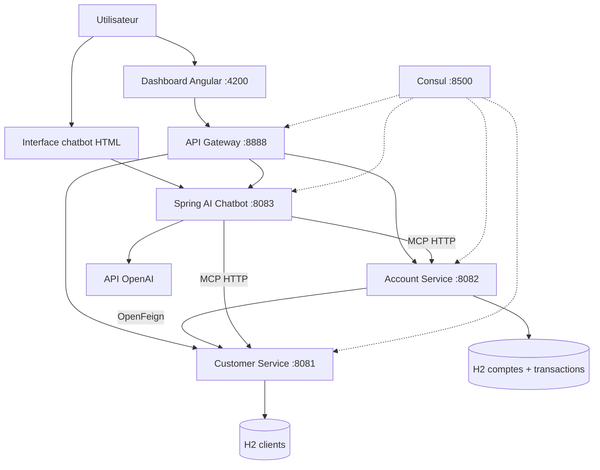
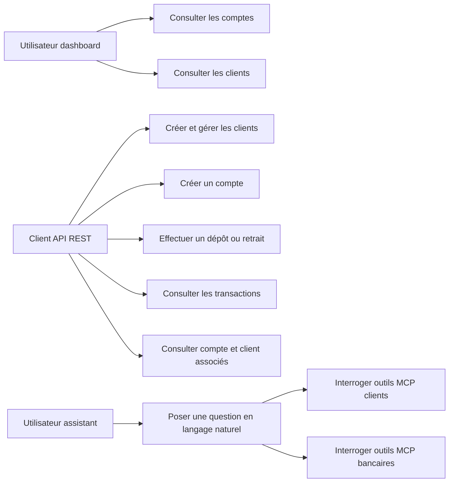
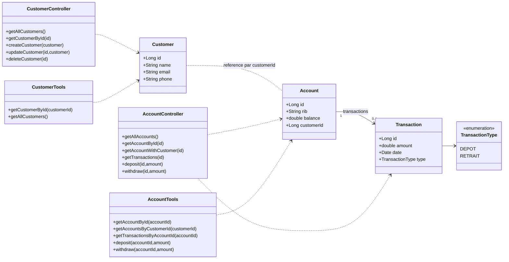
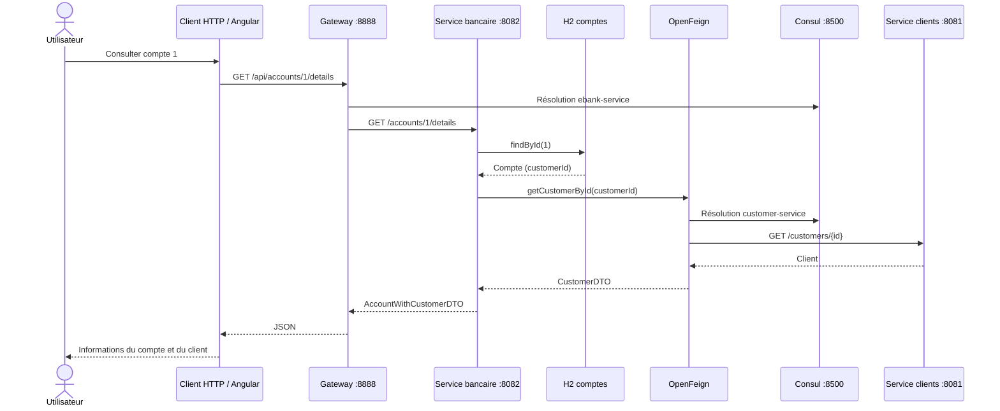
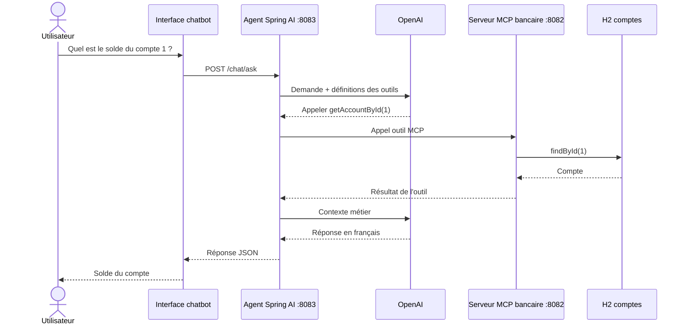
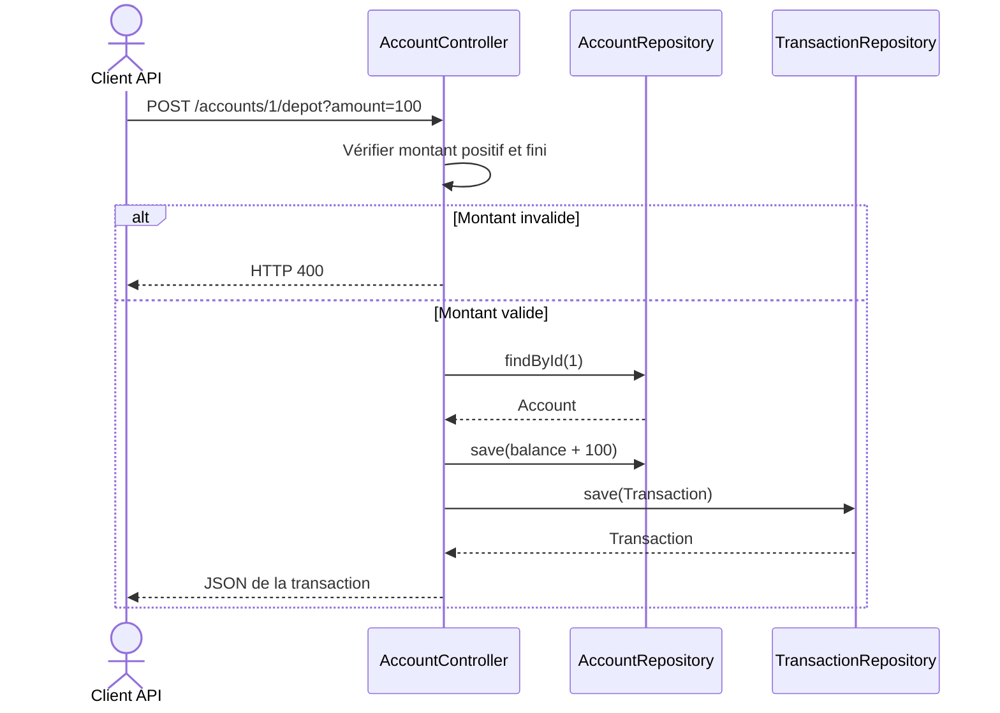

# Architecture technique — Banking Microservices

**Projet d'évaluation : Fatimaezzahra Zahnoune**

Ce dossier décrit l'application pédagogique structurée autour de Spring Boot, Spring Cloud, Spring AI, MCP et Angular. Il accompagne les tutoriels utilisés en cours :

- [Partie 1](https://www.youtube.com/watch?v=cdFz3VemT1Q)
- [Partie 2](https://www.youtube.com/watch?v=JHvxSZTWSsY)

## 1. Vue d'ensemble

Le dossier `banking-platform/` contient les modules suivants :

| Module (dossier) | Service Spring / rôle | Port |
| --- | --- | ---: |
| `customer-service` | `customer-service` : clients et serveur MCP | 8081 |
| `account-service` | `ebank-service` : comptes, transactions, serveur MCP | 8082 |
| `ai-assistant-service` | `ebank-chatbot-service` : agent Spring AI et client MCP | 8083 |
| `api-gateway` | `gateway-service` : point d'entrée API | 8888 |
| `banking-dashboard` | Interface Angular | 4200 |
| `docker-compose.yml` | Registre Consul | 8500 |

**Important :** les noms des dossiers sont distincts des noms `spring.application.name` enregistrés dans Consul. Les routes, les ports et les identifiants Spring restent ceux configurés dans `application.yml`.

### Diagramme de composants

### Principes appliqués

- **Découverte des services** : les services Spring s'enregistrent auprès de Consul.
- **Gateway** : les appels `/api/customers/**`, `/api/accounts/**` et `/api/chat/**` sont redirigés vers les services correspondants.
- **OpenFeign** : le service bancaire consulte les informations d'un client pour enrichir la réponse d'un compte.
- **Persistance** : JPA et H2 en mémoire, une base par service métier.
- **MCP** : les modules clients et bancaires exposent des outils consultables par l'assistant IA.
- **Spring AI** : le client MCP fournit ces outils à un `ChatClient` OpenAI.
- **Angular** : consultation des listes de comptes et de clients via la Gateway.

## Cas d'utilisation

Les acteurs principaux sont l'utilisateur du dashboard, le client API et l'utilisateur de l'assistant conversationnel. Les cas ci-dessous représentent uniquement les opérations présentes dans le code.

## 2. Modèle métier — diagramme de classes

Les deux bases H2 sont indépendantes : `Account.customerId` est un identifiant métier, pas une clé étrangère JPA vers la base des clients.

## 3. Séquences des scénarios essentiels

### 3.1 Consulter un compte enrichi avec son client

### 3.2 Question bancaire en langage naturel

### 3.3 Dépôt ou retrait via l'API REST

**Limite métier :** la sauvegarde du solde et de la transaction devrait être regroupée dans une transaction applicative atomique pour un usage réel. Les exemples restent pédagogiques.

## 4. Interfaces et API

La Gateway expose :
- `/api/customers/**` pour le service clients ;
- `/api/accounts/**` pour les comptes et transactions ;
- `/api/chat/**` pour le chatbot.

Les services exposent aussi leurs endpoints natifs aux ports 8081, 8082 et 8083. Leurs configurations MCP utilisent `/mcp` sur les services 8081 et 8082. Le module Angular appelle la Gateway sur `http://localhost:8888` et `chatbot.html` appelle directement `http://localhost:8083/chat/ask`.

Les routes existantes ont été préservées pour maintenir la compatibilité entre le frontend, Gateway, Consul et Spring AI.

## 5. Exploitation et sécurité

La clé OpenAI n'est pas stockée dans le code : `application.yml` contient `${OPENAI_API_KEY}`. Elle doit être définie localement dans l'environnement d'exécution.

Le dépôt n'a pas besoin de fichier `.env` suivi par Git. Le fichier `.gitignore` exclut les fichiers d'environnement, certificats et clés privées usuelles.

Cette application n'est **pas** un système bancaire de production : elle n'inclut pas l'authentification et l'autorisation nécessaires aux opérations financières. Les outils MCP de dépôt et retrait ne doivent pas être accessibles publiquement sans contrôle d'accès.
